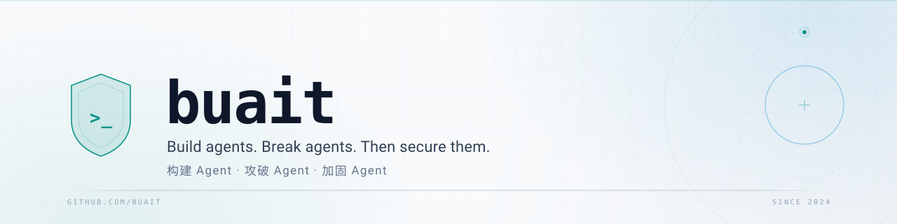

<picture>
  <source media="(prefers-color-scheme: dark)" srcset="./assets/banner-dark.svg">
  <source media="(prefers-color-scheme: light)" srcset="./assets/banner-light.svg">
  
</picture>

**CS student · compilers & database internals · building agent-security tooling**

## About

- CS student, currently deep in compilers and database internals. 
  计算机专业学生，目前专注于编译器和数据库内核。
- Builds agent-security tooling, starting with the skills and MCP servers agents load. 
  构建 Agent 安全工具，从 Agent 加载的技能与 MCP 服务开始。
- Prefers hand-written parsers, golden tests, and code that stays readable a year later. 
  偏好手写解析器、golden 测试，以及一年后仍然可读的代码。
- Learns by reproducing real-world agent skills, then writing down where they fail. 
  通过复现真实 Agent 技能来学习，并记录它们失效的地方。
- Currently building **SkillGuard**, a zero-dependency scanner for agent skills and MCP servers. 
  正在构建 **SkillGuard**：零依赖的 Agent 技能与 MCP 配置安全扫描器。

## Featured

| SECURITY | COMPILERS | RESEARCH |
| :--- | :--- | :--- |
| **[skillguard](https://github.com/buait/skillguard)** | **[c-subset-lexer](https://github.com/buait/c-subset-lexer)** | **[security-audit-skill-repro](https://github.com/buait/security-audit-skill-repro)** |
| Security scanner for AI agent skills & MCP servers. | Hand-written C-subset lexer with a Flex reference implementation and golden tests. | Independent reproduction & teardown of a trending agent security audit skill. |
| `python` `mcp` `security` | `c` `flex` `testing` | `agents` `security` `teardown` |

## Toolbox

## Stats

<picture>
  <source media="(prefers-color-scheme: dark)" srcset="https://github-readme-stats.vercel.app/api?username=buait&amp;show_icons=true&amp;hide_border=true&amp;rank_icon=github&amp;bg_color=0b1020&amp;title_color=5eead4&amp;text_color=cbd5e1&amp;icon_color=38bdf8">
  <source media="(prefers-color-scheme: light)" srcset="https://github-readme-stats.vercel.app/api?username=buait&amp;show_icons=true&amp;hide_border=true&amp;rank_icon=github&amp;bg_color=f8fafc&amp;title_color=0d9488&amp;text_color=334155&amp;icon_color=0284c7">
  
</picture>
<picture>
  <source media="(prefers-color-scheme: dark)" srcset="https://github-readme-stats.vercel.app/api/top-langs/?username=buait&amp;layout=compact&amp;langs_count=6&amp;hide_border=true&amp;bg_color=0b1020&amp;title_color=5eead4&amp;text_color=cbd5e1">
  <source media="(prefers-color-scheme: light)" srcset="https://github-readme-stats.vercel.app/api/top-langs/?username=buait&amp;layout=compact&amp;langs_count=6&amp;hide_border=true&amp;bg_color=f8fafc&amp;title_color=0d9488&amp;text_color=334155">
  
</picture>

<picture>
  <source media="(prefers-color-scheme: dark)" srcset="https://streak-stats.demolab.com/?user=buait&amp;hide_border=true&amp;background=0b1020&amp;stroke=1e293b&amp;ring=5eead4&amp;fire=38bdf8&amp;currStreakNum=f1f5f9&amp;sideNums=e2e8f0&amp;currStreakLabel=5eead4&amp;sideLabels=cbd5e1&amp;dates=64748b">
  <source media="(prefers-color-scheme: light)" srcset="https://streak-stats.demolab.com/?user=buait&amp;hide_border=true&amp;background=f8fafc&amp;stroke=e2e8f0&amp;ring=0d9488&amp;fire=0284c7&amp;currStreakNum=0f172a&amp;sideNums=1e293b&amp;currStreakLabel=0d9488&amp;sideLabels=334155&amp;dates=94a3b8">
  
</picture>

## Now

- **Agent skill security** — treating skill manifests and MCP configs as attack surface. 
  Agent 技能安全：将技能清单与 MCP 配置视为攻击面。
- **Compiler course labs** — lexer, parser, and semantic analysis, written by hand. 
  编译原理课程实验：手写词法、语法与语义分析。
- **Database systems** — storage, indexing, and query execution from first principles. 
  数据库系统：从存储、索引与查询执行的基本原理入手。

## Reach me

GitHub only — [@buait](https://github.com/buait). 
仅限 GitHub：[@buait](https://github.com/buait)。

<i>Build agents. Break agents. Then secure them.</i>

Open to collaboration on agent tooling.

